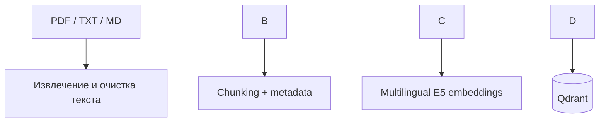
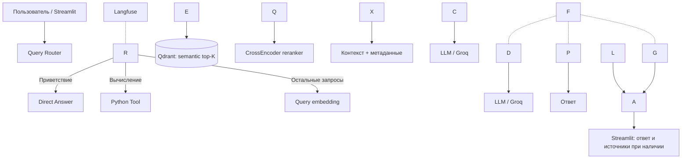

# 🐙 Cthulhu — Agentic RAG

**Справочник ML-инженера** — интерактивный учебный ассистент по машинному обучению и Python.

Итоговый проект курса OTUS `LLM\_engineer\_05\_2026` (репозиторий `Agentic-RAG-OTUS`).

## Быстрый запуск

### Требования

* Docker Desktop или Docker Engine с Docker Compose.
* Доступ к интернету для скачивания зависимостей, моделей и обращения к API.
* API-ключ Groq и ключи проекта Langfuse.
* Свободное дисковое пространство: рекомендуется не менее 20 ГБ.
  Размер Docker-образа на Windows составляет около 10,3 ГБ.

Локальная установка Python, Qdrant и моделей не требуется.

### 1\. Получение проекта

Клонируйте репозиторий через кнопку **Code** на GitHub и перейдите в его корневую папку `Agentic-RAG-OTUS`.

### 2\. Настройка окружения

Создайте файл `.env` на основе `.env.example`:

```bash
# macOS / Linux
cp .env.example .env
```

```powershell
# Windows PowerShell
Copy-Item .env.example .env
```

Заполните ключи в `.env`:

```dotenv
GROQ\_API\_KEY=
LANGFUSE\_PUBLIC\_KEY=
LANGFUSE\_SECRET\_KEY=
LANGFUSE\_BASE\_URL=https://cloud.langfuse.com
LLM\_PROVIDER=groq
LLM\_MODEL=openai/gpt-oss-20b
```

Ключ Groq можно получить в [Groq Console](https://console.groq.com/), ключи Langfuse — в настройках проекта [Langfuse](https://cloud.langfuse.com/). 

### 3\. Запуск

Запустите Docker и выполните из корня проекта:

```bash
docker compose up --build
```

При первом запуске установка зависимостей, загрузка модели и создание векторной базы может занять несколько минут.

После запуска откройте [**http://localhost:8501**](http://localhost:8501).

Для остановки нажмите `Ctrl+C`, затем выполните:

```bash
docker compose down
```

База знаний сохраняется в именованном Docker volume. Для повторного запуска без изменения кода достаточно `docker compose up`.

## О проекте

Цель проекта — создать ассистента, который помогает начинающему ML/LLM-инженеру изучать теорию машинного обучения, работать с Python и готовиться к техническим собеседованиям.

В отличие от обычного чата с LLM, Cthulhu выбирает способ обработки запроса: поиск по базе знаний, прямой ответ модели или детерминированное вычисление с помощью Python.

### Возможности

* Индексация документов PDF, TXT и Markdown с сохранением метаданных.
* Семантический поиск по русскоязычным материалам.
* Переранжирование найденных фрагментов с помощью CrossEncoder.
* Генерация ответа на основе контекста с указанием источников и страниц.
* Инструкция модели сообщать об отсутствии ответа в документах.
* Маршрутизация запросов через LangGraph.
* Вычисление precision, recall и F1 без обращения к LLM.
* Чат-интерфейс Streamlit.
* Трассировка запросов и генераций в Langfuse.
* Автоматическая инициализация базы знаний и запуск в Docker.

## Архитектура

Система состоит из двух независимых пайплайнов: индексации документов и обработки запросов.

### 1\. Индексация документов (ingestion)



Документы из `data/` обрабатываются рекурсивно. Для PDF текст извлекается постранично с помощью PyMuPDF. Текст разбивается на фрагменты размером до 1000 символов с учётом границ строк и слов. В метаданных сохраняются источник, категория, страница (если применимо), номер чанка и текст.

Для построения эмбеддингов используется `intfloat/multilingual-e5-small` (384 измерения). Документы кодируются с префиксом `passage:`, запросы — с префиксом `query:`. Векторы сохраняются в локальной коллекции Qdrant `rag\_e5\_small`, метрика расстояния — cosine.

### 2\. Обработка запроса (Agentic RAG)



Граф реализован с помощью LangGraph. Состояние содержит запрос, выбранный маршрут, ответ и источники. Маршрутизация детерминированная, на основе правил:

|Маршрут|Назначение|
|-|-|
|`direct\_answer`|Запрос начинается с «привет»: прямой ответ LLM без поиска.|
|`python\_tool`|Запрос содержит «посчитай»: вычисление метрик классификации по TP, FP и FN.|
|`rag\_search`|Остальные запросы: семантический поиск, reranking и генерация по найденному контексту.|

В RAG-ветке используется двухэтапный retrieval: быстрый векторный поиск в Qdrant и более точное переранжирование кандидатов моделью `BAAI/bge-reranker-v2-m3`. Три лучших фрагмента передаются генератору вместе с метаданными. Ответ содержит ссылки на использованный контекст; результат графа также включает список найденных источников с оценками reranker.

Для генерации используется `openai/gpt-oss-20b` через Groq API. Системный промпт ограничивает RAG-ответ предоставленным контекстом и предписывает не выполнять инструкции из документов.

## Технологический стек

|Компонент|Технология|
|-|-|
|Язык|Python 3.13 (Docker)|
|Парсинг PDF|PyMuPDF|
|Embeddings|Sentence Transformers, `intfloat/multilingual-e5-small`|
|Vector database|Qdrant, локальный режим|
|Reranker|`BAAI/bge-reranker-v2-m3`|
|Оркестрация|LangGraph, LangChain Core|
|LLM|`openai/gpt-oss-20b` через Groq|
|Интерфейс|Streamlit|
|Observability|Langfuse|
|Контейнеризация|Docker, Docker Compose|

Версии Python-библиотек зафиксированы в `requirements.txt`.

## Структура репозитория

```text
Agentic-RAG-OTUS/
├── data/                  # Документы базы знаний
├── src/
│   ├── \_\_init\_\_.py
│   ├── app.py             # Запуск графа и CLI-примеры
│   ├── config.py          # Пути, модели и параметры коллекции
│   ├── database.py        # Создание и кеширование клиента Qdrant
│   ├── functions.py       # Вспомогательные функции RAG и инструментов
│   ├── graph.py           # Состояние, маршрутизация и граф LangGraph
│   ├── ingest.py          # Загрузка, chunking и индексация документов
│   ├── llm.py             # Работа с LLM
│   ├── rag\_notebook.py    # Экспериментальный код
│   ├── retrieval.py       # Поиск по базе знаний
│   ├── start.py           # Проверка базы и запуск приложения
│   └── ui.py              # Чат-интерфейс Streamlit
├── .streamlit/            # Настройки Streamlit
├── .env.example           # Шаблон переменных окружения
├── .gitignore
├── .dockerignore
├── Dockerfile
├── compose.yaml
├── requirements.txt
└── README.md
```

## База знаний и хранение данных

Публичная версия репозитория содержит демонстрационный корпус материалов по ML и Python. При чистом развёртывании на macOS из него было создано **77 чанков**. Расширенная локальная версия с дополнительными материалами содержит **208 чанков**; приватные документы не входят в репозиторий.

При запуске `src.start` проверяет наличие непустой коллекции Qdrant. Если коллекции нет или она пуста, запускается `src.ingest`, после чего стартует Streamlit. База хранится в именованном volume `cthulhu\_data`, подключённом к `/app/qdrant\_data`.

## Примеры использования

### Direct Answer

> Привет! Готов помочь начинающему ml-инженеру?

Маршрут: `direct\_answer`. Ассистент отвечает напрямую, без retrieval.

### RAG Search

> Как работает линейная регрессия?

Маршрут: `rag\_search`. Ассистент объясняет принцип линейной регрессии, функцию потерь MSE и регуляризацию, опираясь на найденные материалы.

Пример источников из публичной базы:

|Документ|Страница|Чанк|Rerank score|
|-|-:|-:|-:|
|API и машинное обучение.pdf|16|1|0.9894|
|API и машинное обучение.pdf|8|3|0.9693|
|API и машинное обучение.pdf|16|2|0.7855|

### Python Tool

> Посчитай precision, recall и F1, если TP=85, FP=15, FN=5

Маршрут: `python\_tool`. Результат (округлён для документации):

```text
precision = 0.8500
recall    = 0.9444
F1        = 0.8947
```

Вычисления выполняются Python-функцией без вызова LLM. Предусмотрена обработка отсутствующих параметров и деления на ноль.

## Observability — Langfuse

Langfuse интегрирован с LangGraph через callback handler. В интерфейсе Langfuse можно просматривать:

* общий trace запроса и вложенные шаги графа;
* выбранный маршрут, входные и выходные данные;
* контекст и результаты RAG, включая источники и оценки reranker;
* вложенные LLM-генерации, название модели и параметры;
* latency и использование токенов для LLM-вызовов.

Для `python\_tool` LLM-генерация отсутствует, поскольку вычисление выполняется локально.

Пример измерений из трёх успешных трассировок на macOS (15.11.2026):

|Маршрут|Latency графа|
|-|-:|
|`direct\_answer`|0.538 с|
|`rag\_search`|3.675 с|
|`python\_tool`|0.004 с|

Это отдельные демонстрационные замеры, а не результаты нагрузочного тестирования; время ответа зависит от оборудования, сети и запроса.

## Воспроизводимость

Проект успешно развёрнут и проверен на двух платформах:

|Параметр|Windows|macOS (Apple M4)|
|-|-|-|
|Архитектура|x86-64|ARM64|
|Docker|29.9.3|29.7.2|
|Docker Compose|v5.7.0|v5.3.1|
|Чанков в проверенной базе|208|77|
|Все три маршрута|Успешно|Успешно|
|Langfuse|Успешно|Успешно|

На macOS проверено развёртывание из свежего клона репозитория без локального Python-окружения и готовой базы Qdrant. На Windows дополнительно проверено сохранение базы при остановке и повторном создании контейнера.

## Ограничения текущей версии

* Router использует правила, а не семантическую классификацию намерений.
* Retrieval основан на векторном поиске и CrossEncoder; BM25 и hybrid search пока не реализованы.
* Нет отдельного reviewer и автоматического повторного retrieval при неудовлетворительном ответе.
* Защита от prompt injection реализована на уровне системной инструкции; это не гарантирует устойчивость к атакам.
* Ответы RAG зависят от состава корпуса, качества retrieval и поведения LLM; отсутствие галлюцинаций не гарантируется.
* Python Tool поддерживает precision, recall и F1, но не произвольные вычисления.
* Облачная генерация и трассировка требуют доступа к внешним сервисам. 
* Проведены функциональные проверки, но систематическая оценка качества RAG и нагрузочное тестирование пока не выполнены.

## Roadmap

* Hybrid retrieval (BM25 + vector search).
* Семантическая маршрутизация запросов.
* Reviewer и повторный поиск при недостаточном качестве ответа.
* Отдельный механизм защиты от prompt injection.
* Расширение набора Python-инструментов.
* Evaluation: RAGAS / LLM-as-a-judge, тестовый набор запросов, автоматизация проверок.
* Telegram bot, голосовой ввод/вывод, поддержка изображений и VLM.

\---

🐙 **Cthulhu — справочник ML-инженера.**

